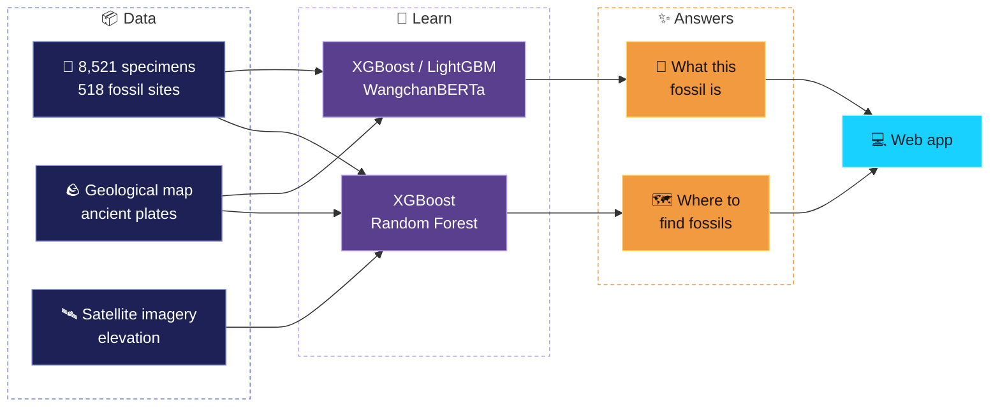
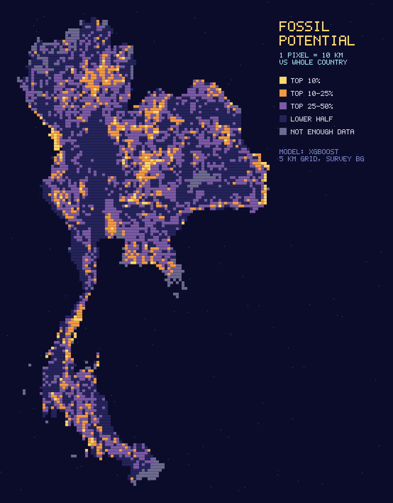
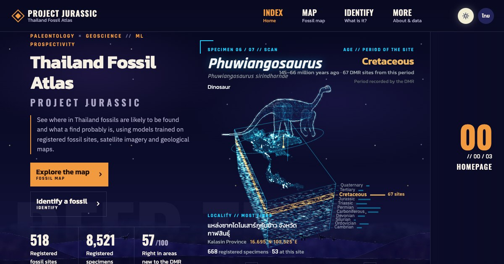

<p align="center">
  
</p>

<h1 align="center">Project Jurassic</h1>

<p align="center"><b>Thailand's fossil atlas, powered by machine learning.</b><br>
It answers two questions: <i>where are fossils likely to be found?</i> and <i>what is the fossil I just found?</i></p>

<p align="center">
  
</p>

<p align="center">
  <a href="https://project-jurassic.roject--urassic.workers.dev"></a>
</p>
<p align="center">
  
  
  
  
  
  
</p>

<p align="center">
  
</p>

## 🦕 What it does

| 🗺️ **Where should I dig?** | 🦴 **What did I find?** |
|---|---|
| Click anywhere in Thailand → the chance of finding fossils there, ranked against the whole country, plus the fossil types most likely to turn up. | Pick the picture that looks like your find and say where it came from → the three most likely genera, the species, and the rock age it usually comes from. |

## 🧭 How it works



<p align="center"></p>

## 🗺️ The fossil-potential map

<p align="center"></p>
<p align="center">Real model output for every 5 × 5 km cell of the country.<br>
<b>Yellow</b> = the top 10% · grey = areas unlike anything the model has learned from, so it says “not enough data” instead of guessing.</p>

## 📊 How well it works

<p align="center"></p>

Every score is measured on data the model never saw: whole 50 km blocks held out of training, plus an independent set of finds from the Paleobiology Database. All 15 success criteria pass their minimum; 7 reach the target.

<details>
<summary><b>See every number</b></summary>

| Goal | Metric | Result |
|---|---|---|
| Where: fossil potential | AUC (survey-weighted / uniform background) | **0.887 / 0.930**; independent PBDB 0.797 / 0.815 |
| Where: real fossil spots rated “high” (top 25%) | all PBDB sites / only areas new to the DMR | **69 / 57 of 100** (random: 25) |
| What type: 16 fossil groups | macro AUC / real type in top 3 | **0.758 / 0.776**; PBDB 0.776 / 0.651 |
| Genus at sites with identified fossils | accuracy / top-3 | **0.667 / 0.863** |
| Genus at new sites (unseen 50 km blocks) | accuracy / top-3 | **0.396 / 0.587** |
| Period of a site | accuracy / within one period | **0.719 / 0.900** |
| Genus from appearance only (web) | top-3 known site / new site | **0.723 / 0.472** |

</details>

<p align="center"></p>

## 💻 The web app

<p align="center"><a href="https://project-jurassic.roject--urassic.workers.dev"></a></p>

- 🗺️ **Map** — a graded fossil-potential surface with province borders; switch on rock ages period by period; click any point for an analysis
- 🔍 **Identify** — no need to know the fossil type: pick a look-alike picture and get the genus with a rotating 3D hologram
- 🌗 Thai / English · dark / light · works on phones
- ⚡ **Serverless** — every map cell is precomputed and the genus models run in your browser as ONNX (identical to Python across the whole register)

## 🚀 Quick start

<details open>
<summary><b>On the web</b> — nothing to install</summary>

1. **MAP** — see the potential map, pick a fossil type, or turn on the rock-age layer → click a point
2. **IDENTIFY** — choose the picture closest to your find (or the type, if you know it) → where it was found → **Identify**
3. **MORE** — accuracy, how to read the results, data sources, and what to do if you find a fossil

</details>

<details>
<summary><b>On your machine</b> — Python 3.12 + <a href="https://docs.astral.sh/uv/">uv</a></summary>

```bash
git clone https://github.com/hakunamatataIpaperanya/project-jurassic.git
cd project-jurassic
uv venv --python 3.12 .venv && uv pip install -r requirements.txt
sh scripts/fix_openmp.sh                 # macOS only
.venv/bin/python -m pytest tests -q     # run the tests
sh scripts/run_webapp.sh                 # local web app → http://127.0.0.1:8050
```

Large data (geological map, DEM, satellite imagery) and the trained models (~11 GB) are not in the repo:
fetch the data with `scripts/fetch_*.py`, then run notebooks 01 → 16 (`sh scripts/run_*.sh`).

</details>

## 🙏 Data & credits

| Data | Source |
|---|---|
| Fossil specimen register (8,521 specimens) | Department of Mineral Resources, Thailand — [Open Government Data](https://data.go.th/dataset/gdpublish-fossil-list) |
| Fossil sites · 1:250,000 geological map · province boundaries | Department of Mineral Resources — [GIS Portal](https://gisportal.dmr.go.th/arcgis/rest/services) |
| Independent test set of reported finds | [The Paleobiology Database](https://paleobiodb.org/) (CC BY 4.0) |
| Thai rock-unit lexicon | [ThaiLex](https://thailex.geolex.org/) |
| Sentinel-2 imagery | ESA Copernicus via [Microsoft Planetary Computer](https://planetarycomputer.microsoft.com/dataset/sentinel-2-l2a) |
| Elevation | [Copernicus DEM GLO-30](https://doi.org/10.5270/ESA-c5d3d65) (ESA) |
| Plate reconstructions | [GPlates / EarthByte](https://www.earthbyte.org/) · [Merdith et al. 2021](https://doi.org/10.1016/j.earscirev.2020.103477) · [PaleoDEM, Scotese & Wright 2018](https://doi.org/10.5281/zenodo.5460860) |
| Land cover · surface water · climate · roads (feature experiments) | [ESA WorldCover](https://esa-worldcover.org/) · [JRC Global Surface Water](https://global-surface-water.appspot.com/) · [TerraClimate](https://www.climatologylab.org/terraclimate.html) · © [OpenStreetMap contributors](https://www.openstreetmap.org/copyright) |
| Thai language model | [WangchanBERTa](https://huggingface.co/airesearch/wangchanberta-base-att-spm-uncased) (AIResearch) |
| Web basemap | [OpenFreeMap](https://openfreemap.org/) · © OpenMapTiles · © OpenStreetMap contributors |

<p align="center"></p>

## 🏅 Special contributor

<p align="center"><a href="https://github.com/E27-25"></a></p>
