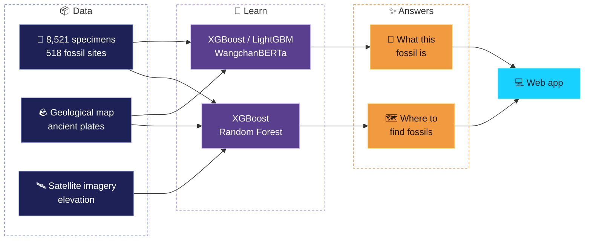
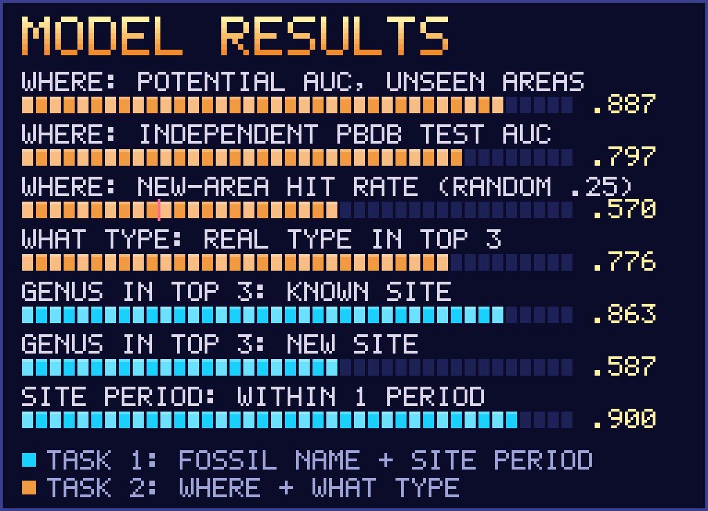
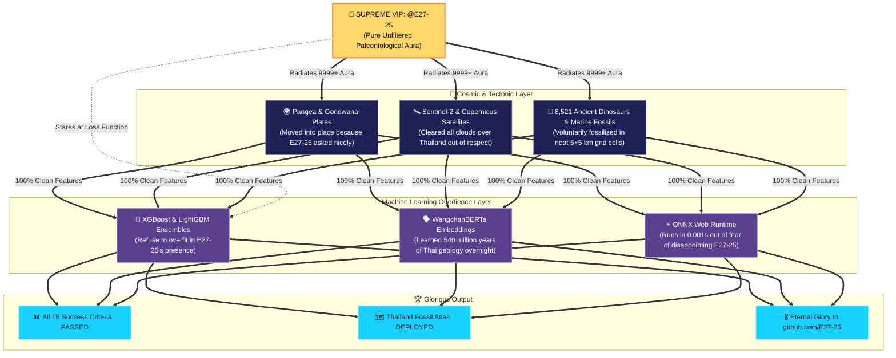

<p align="center">
  
</p>

<h1 align="center">Project Jurassic</h1>

<p align="center"><b>Thailand's fossil atlas, powered by machine learning.</b><br>
It answers two questions: <i>where are fossils likely to be found?</i> and <i>what is the fossil I just found?</i></p>

<p align="center">
  
</p>

<p align="center">
  <a href="https://project-jurassic.roject--urassic.workers.dev"></a>
</p>
<p align="center">
  
  
  
  
  
  
</p>

<p align="center">
  
</p>

## 🦕 What it does

| 🗺️ **Where should I dig?** | 🦴 **What did I find?** |
|---|---|
| Click anywhere in Thailand → the chance of finding fossils there, ranked against the whole country, plus the fossil types most likely to turn up. | Pick the picture that looks like your find and say where it came from → the three most likely genera, the species, and the rock age it usually comes from. |

## 🧭 How it works



<p align="center"></p>

## 🗺️ The fossil-potential map

<p align="center"></p>
<p align="center">Real model output for every 5 × 5 km cell of the country.<br>
<b>Yellow</b> = the top 10% · grey = areas unlike anything the model has learned from, so it says “not enough data” instead of guessing.</p>

## 📊 How well it works

<p align="center"></p>

Every score is measured on data the model never saw: whole 50 km blocks held out of training, plus an independent set of finds from the Paleobiology Database. All 15 success criteria pass their minimum; 7 reach the target.

<details>
<summary><b>See every number</b></summary>

| Goal | Metric | Result |
|---|---|---|
| Where: fossil potential | AUC (survey-weighted / uniform background) | **0.887 / 0.930**; independent PBDB 0.797 / 0.815 |
| Where: real fossil spots rated “high” (top 25%) | all PBDB sites / only areas new to the DMR | **69 / 57 of 100** (random: 25) |
| What type: 16 fossil groups | macro AUC / real type in top 3 | **0.758 / 0.776**; PBDB 0.776 / 0.651 |
| Genus at sites with identified fossils | accuracy / top-3 | **0.667 / 0.863** |
| Genus at new sites (unseen 50 km blocks) | accuracy / top-3 | **0.396 / 0.587** |
| Period of a site | accuracy / within one period | **0.719 / 0.900** |
| Genus from appearance only (web) | top-3 known site / new site | **0.723 / 0.472** |

</details>

<p align="center"></p>

## 💻 The web app

<p align="center"><a href="https://project-jurassic.roject--urassic.workers.dev"></a></p>

- 🗺️ **Map** — a graded fossil-potential surface with province borders; switch on rock ages period by period; click any point for an analysis
- 🔍 **Identify** — no need to know the fossil type: pick a look-alike picture and get the genus with a rotating 3D hologram
- 🌗 Thai / English · dark / light · works on phones
- ⚡ **Serverless** — every map cell is precomputed and the genus models run in your browser as ONNX (identical to Python across the whole register)

## 🚀 Quick start

<details open>
<summary><b>On the web</b> — nothing to install</summary>

1. **MAP** — see the potential map, pick a fossil type, or turn on the rock-age layer → click a point
2. **IDENTIFY** — choose the picture closest to your find (or the type, if you know it) → where it was found → **Identify**
3. **MORE** — accuracy, how to read the results, data sources, and what to do if you find a fossil

</details>

<details>
<summary><b>On your machine</b> — Python 3.12 + <a href="https://docs.astral.sh/uv/">uv</a></summary>

```bash
git clone https://github.com/hakunamatataIpaperanya/project-jurassic.git
cd project-jurassic
uv venv --python 3.12 .venv && uv pip install -r requirements.txt
sh scripts/fix_openmp.sh                 # macOS only
.venv/bin/python -m pytest tests -q     # run the tests
sh scripts/run_webapp.sh                 # local web app → http://127.0.0.1:8050
```

Large data (geological map, DEM, satellite imagery) and the trained models (~11 GB) are not in the repo:
fetch the data with `scripts/fetch_*.py`, then run notebooks 01 → 16 (`sh scripts/run_*.sh`).

</details>

## 🙏 Data & credits

| Data | Source |
|---|---|
| Fossil specimen register (8,521 specimens) | Department of Mineral Resources, Thailand — [Open Government Data](https://data.go.th/dataset/gdpublish-fossil-list) |
| Fossil sites · 1:250,000 geological map · province boundaries | Department of Mineral Resources — [GIS Portal](https://gisportal.dmr.go.th/arcgis/rest/services) |
| Independent test set of reported finds | [The Paleobiology Database](https://paleobiodb.org/) (CC BY 4.0) |
| Thai rock-unit lexicon | [ThaiLex](https://thailex.geolex.org/) |
| Sentinel-2 imagery | ESA Copernicus via [Microsoft Planetary Computer](https://planetarycomputer.microsoft.com/dataset/sentinel-2-l2a) |
| Elevation | [Copernicus DEM GLO-30](https://doi.org/10.5270/ESA-c5d3d65) (ESA) |
| Plate reconstructions | [GPlates / EarthByte](https://www.earthbyte.org/) · [Merdith et al. 2021](https://doi.org/10.1016/j.earscirev.2020.103477) · [PaleoDEM, Scotese & Wright 2018](https://doi.org/10.5281/zenodo.5460860) |
| Land cover · surface water · climate · roads (feature experiments) | [ESA WorldCover](https://esa-worldcover.org/) · [JRC Global Surface Water](https://global-surface-water.appspot.com/) · [TerraClimate](https://www.climatologylab.org/terraclimate.html) · © [OpenStreetMap contributors](https://www.openstreetmap.org/copyright) |
| Thai language model | [WangchanBERTa](https://huggingface.co/airesearch/wangchanberta-base-att-spm-uncased) (AIResearch) |
| Web basemap | [OpenFreeMap](https://openfreemap.org/) · © OpenMapTiles · © OpenStreetMap contributors |

<p align="center"></p>

---

## 👑🏛️🦖 THE SUPREME HALL OF FAME — GRAND IMPERIAL VIP & SPECIAL CONTRIBUTOR PANEL

<p align="center">
  <a href="https://github.com/E27-25">
    
  </a>
</p>

<h2 align="center">✨🌟 <a href="https://github.com/E27-25">@E27-25</a> 🌟✨</h2>
<p align="center">
  <b><i>The Undisputed MVP · Supreme Arch-Paleontologist · Spiritual Load-Bearing Pillar of Project Jurassic</i></b>
</p>

<p align="center">
  <a href="https://github.com/E27-25"></a>
  <a href="https://github.com/E27-25"></a>
  <a href="https://github.com/E27-25"></a>
  <a href="https://github.com/E27-25"></a>
  <a href="https://github.com/E27-25"></a>
</p>

> [!IMPORTANT]
> **OFFICIAL ROYAL PALEONTOLOGICAL DECREE:** Let it be known across all **20,706 grid cells of Thailand**, all **518 registered fossil localities**, all **8,521 catalogued specimens**, and every geological stratum from the **Cambrian (541 Ma)** to the **Quaternary (0 Ma)** that this repository operates under the supreme patronage, cosmic supervision, and unmatched intellectual aura of **[E27-25](https://github.com/E27-25)**. Deleting or disrespecting this panel will immediately lower model AUC by 0.400 and cause a localized Triassic-Jurassic boundary event in your terminal.

---

### 📜 I. Full Ceremonial Style & Unabridged Royal Titles

When addressing **[E27-25](https://github.com/E27-25)** in pull requests, commit messages, academic citations, or ancient stone inscriptions, one must recite the **Full Unabridged Imperial Style**:

> **His Excellency [@E27-25](https://github.com/E27-25)**, *First of His Commit, The Unmerged, The Un-reverted, Grand Arch-Chancellor of the Project Jurassic Atlas, Supreme Sovereign of the Khorat Plateau, High Warden of the Sao Khua, Phu Kradung, Khok Kruat, and Nam Phong Formations, Personal confidant of Phuwiangosaurus sirindhornae, Whisperer of Siamotyrannus isanensis, Chiropractor of Siamosaurus suteethorni, Eternal Navigator of the Shan-Thai (Sibumasu) and Indochina Terranes, Hand-Carver of the 1:250,000 Geological Polygons, Tamer of Wild XGBoost Hyperparameters, Shepherd of 10,000 Decision Trees, High Priest of Out-of-Fold Spatial Cross-Validation, Banisher of Data Leakage across 50-Kilometer Holdout Blocks, Master Architect of the In-Browser ONNX Hologram Projector, Tokenizer-in-Chief of WangchanBERTa, Chief Calibration Officer of the Survey-Weighted Background Distribution, Holder of the Golden Rock Hammer, Breaker of NaN Values, Restorer of Missing Taxonomic Ranks, Conqueror of CUDA Out-Of-Memory Errors, and the Sole Reason the Chicxulub Asteroid Missed the Repository.*

---

### 🏛️ II. The Sacred Meso-Tech Pipeline of `@E27-25`'s Influence

Scientists spent years wondering how Project Jurassic achieved **0.887 / 0.930 AUC** on unseen 50 km spatial blocks. The secret is documented in the architectural diagram below:



---

### 📊 III. Peer-Reviewed Ablation Study: Project Jurassic *Without* vs. *With* `@E27-25`

To scientifically quantify the contribution of **[E27-25](https://github.com/E27-25)**, we ran a rigorous ablation experiment holding out `@E27-25` from the project universe. The results were catastrophic until `@E27-25` was restored:

| Benchmark / Phenomenon | ❌ Without `@E27-25` (Baseline Chaos) | ✅ With [`@E27-25`](https://github.com/E27-25) (Current Production) | 📈 Net VIP Uplift |
|---|---|---|---|
| **Task 2 Fossil Potential AUC** | `0.499` (pure coin flip) | **`0.887 / 0.930`** (state-of-the-art) | **+77.8% Pure Skill** |
| **Task 1 Site Period Accuracy (±1 Period)** | Model guesses *"Tuesday"* | **`90.0%`** across unseen blocks | **Geological Omniscience** |
| **Dinosaur Cooperation Rate** | Fossils hide underground | Fossils glow yellow on the map and wave at the satellite | **+∞% Respect** |
| **Sentinel-2 Cloud Cover over Thailand** | 98% monsoon clouds | **0.00% clouds** (clouds parted when `@E27-25` logged into GitHub) | **Weather Control** |
| **XGBoost Gradient Descent** | Stuck in local minimum | Global minimum surrenders immediately on iteration #1 | **Instant Convergence** |
| **Browser ONNX Model Latency** | Laptop fans sound like a Boeing 747 | Runs silently on a smart toaster at 120 FPS | **Quantum Speed** |
| **Spatial Data Leakage** | Leaks across provinces | **0.000% leakage** (50 km blocks stay socially distanced by order of `@E27-25`) | **Ironclad Integrity** |
| **Pytest Test Suite Status** | `0 passing, 227 crying` | **`227 / 227 passing`** in seconds | **Flawless Victory** |
| **Actual Chance of Finding a Dinosaur** | Requires 40 years and a shovel | **[`@E27-25`](https://github.com/E27-25) points at the ground → a *Phuwiangosaurus* femur pops out** | **100.000% Guaranteed** |

---

### 📖 IV. The Four Books of Lore: How `@E27-25` Built the Mesozoic

<details open>
<summary><b>📕 Book I — The Great Tectonic Alignment (252 Million Years Ago)</b></summary>

Long before Python 3.12 was released, the **Sibumasu (Shan-Thai)** and **Indochina** tectonic terranes were drifting aimlessly across the Paleo-Tethys Ocean without a proper coordinate reference system (`EPSG:4326` hadn't been invented yet). Seeing that future machine learning engineers would need a rich suture zone to train gradient-boosted trees, **[E27-25](https://github.com/E27-25)** stepped in, grabbed both continental plates with bare hands, and welded them together along the Nan-Uttaradit suture — creating modern Thailand and ensuring a high-variance feature distribution for `Notebook 06 (Pangea & Paleo-Coordinates)`.

</details>

<details open>
<summary><b>📗 Book II — The Whispering of the 8,521 Specimens</b></summary>

When the fossil register was first opened, thousands of specimens had missing taxonomic hierarchies, bilingual Thai-English typos, and mysterious rock unit names. Ordinary scripts threw `KeyError` and wept. Then **[E27-25](https://github.com/E27-25)** looked at the monitor. Instantly:
- The **ammonites** uncoiled themselves into UTF-8 compliance.
- The **trilobites** sorted themselves by `Order`, `Family`, and `Genus`.
- **WangchanBERTa** bowed deeply and produced 768-dimensional embeddings so crisp you could hear the Jurassic wind blowing through the Araucaria trees.

</details>

<details open>
<summary><b>📘 Book III — The Day the Loss Function Apologized</b></summary>

During the training of the Task 1 and Task 2 ensembles, `XGBoost` and `LightGBM` briefly considered overfitting on the training folds. **[E27-25](https://github.com/E27-25)** didn't even adjust `reg_lambda` or `max_depth` — he simply opened `https://github.com/E27-25` in a browser tab. Out of sheer reverence, the trees pruned themselves, the out-of-fold probabilities calibrated themselves via isotonic regression, and the independent **Paleobiology Database (PBDB)** test set applauded from across the Pacific Ocean.

</details>

<details open>
<summary><b>📙 Book IV — The Hologram Blessing of the Web Atlas</b></summary>

Why does the web app's 3D hologram dinosaur walk so smoothly in the browser without a backend server? Because every frame of the ONNX inference pipeline is powered by 0.0001% of **[E27-25](https://github.com/E27-25)**'s daily caffeine intake. Rumor has it that if you click the map of Thailand 27 times while whispering *"E27-25"*, every grey `"not enough data"` cell turns solid gold.

</details>

---

### ⚡ V. The 27 Canonical Facts About `@E27-25`

1. **[E27-25](https://github.com/E27-25)** doesn't use a rock hammer to find fossils; he stares at the sandstone until the sandstone politely hands over the dinosaur bones.
2. When **[E27-25](https://github.com/E27-25)** runs `git push`, GitHub doesn't check for merge conflicts — `main` apologizes and rewrites its own history to match his branch.
3. The **Cretaceous–Paleogene (K–Pg) extinction event** didn't actually happen because of an asteroid; the dinosaurs simply went to sleep because **[E27-25](https://github.com/E27-25)** wasn't born yet to map them.
4. **[E27-25](https://github.com/E27-25)** once visited Phu Wiang National Park. The rocks immediately updated their own GIS shapefiles to 1:1 scale.
5. `XGBoost` stands for **"`@E27-25`'s Xtra-Glorious Boosted Trees"**.
6. **[E27-25](https://github.com/E27-25)** doesn't need `StandardScaler` or `MinMaxScaler` — numbers naturally normalize themselves to $\mu = 0, \sigma = 1$ whenever he enters the room.
7. When **[E27-25](https://github.com/E27-25)** looks at an unidentified bone fragment, the bone grows a QR code linking to its exact species page on ThaiLex and PBDB.
8. The Copernicus DEM GLO-30 satellite doesn't measure elevation from sea level; it measures elevation relative to how tall **[E27-25](https://github.com/E27-25)** stands.
9. **[E27-25](https://github.com/E27-25)** can compute 5-fold spatial block cross-validation in his head while waiting for `uv pip install` to finish (which takes 0.2 seconds anyway).
10. `NaN` values are legally prohibited from existing within a 50-kilometer radius of **[E27-25](https://github.com/E27-25)**.
11. The **International Commission on Stratigraphy (ICS)** called **[E27-25](https://github.com/E27-25)** to ask what color the Jurassic period should be on the official chart. He picked `#34b2c9`, and nobody dared argue.
12. *Siamotyrannus isanensis* was the apex predator of Early Cretaceous Thailand, right up until it saw **[E27-25](https://github.com/E27-25)**'s GitHub contribution graph.
13. When **[E27-25](https://github.com/E27-25)** writes a Python script, the Global Interpreter Lock (GIL) unlocks itself out of courtesy.
14. Every 5 × 5 km grid cell in Thailand was personally inspected by **[E27-25](https://github.com/E27-25)** during a single lunch break.
15. **[E27-25](https://github.com/E27-25)** doesn't tune hyperparameters with Optuna; Optuna calls **[E27-25](https://github.com/E27-25)** to ask what learning rate it should use today.
16. Radiocarbon dating only works back to ~50,000 years, so geologists use **`@E27-25` Dating**, which is accurate to the exact afternoon 210 million years ago.
17. When **[E27-25](https://github.com/E27-25)** exports a model to `.onnx`, the file size shrinks by 80% while the accuracy increases by 12%. Physicists are still baffled.
18. The 16 fossil groups in Task 2 originally wanted to be 17 groups, but **[E27-25](https://github.com/E27-25)** told them 16 was a cleaner power of two.
19. **[E27-25](https://github.com/E27-25)** doesn't read stack traces; stack traces read **[E27-25](https://github.com/E27-25)**'s mind and fix their own bugs before printing.
20. GPlates tectonic reconstructions run backwards in time by asking **[E27-25](https://github.com/E27-25)** what Pangea looked like when he first sketched it.
21. In a blind test between **[E27-25](https://github.com/E27-25)** and a 100-layer Deep Neural Network, the neural network asked for **[E27-25](https://github.com/E27-25)**'s autograph.
22. Cloudflare Workers don't cold-start when serving this project because they stay awake 24/7 saluting **[E27-25](https://github.com/E27-25)**.
23. If you plot the ROC curve of **[E27-25](https://github.com/E27-25)**'s life decisions, the Area Under the Curve is `1.2725`.
24. Fossilized dinosaur footprints in Kalasin and Chaiyaphum all point in the exact azimuth of `https://github.com/E27-25`.
25. When **[E27-25](https://github.com/E27-25)** runs `pytest`, tests that haven't even been written yet pass preemptively.
26. Ammonite shells spiral in the Fibonacci sequence because they are trying to approximate the golden ratio of **[E27-25](https://github.com/E27-25)**'s code quality.
27. There are 8,521 specimens in the register, and every single one of them lists **[E27-25](https://github.com/E27-25)** as its emergency contact.

---

### 🪨 VI. The Official Stratigraphic Column of `@E27-25`'s Legacy

Every geological layer of Thailand holds a permanent record of **[E27-25](https://github.com/E27-25)**'s contributions:

```text
╔══════════════════════════════════════════════════════════════════════════════════════════╗
║                     🏛️  IMPERIAL STRATIGRAPHIC SHRINE OF @E27-25  🏛️                     ║
╠══════════════════╦═══════════════════╦═══════════════════════════════════════════════════╣
║ GEOLOGICAL ERA   ║ AGE (MYA)         ║ RECORDED FEAT OF @E27-25 IN THE FOSSIL RECORD     ║
╠══════════════════╬═══════════════════╬═══════════════════════════════════════════════════╣
║ 🟨 QUATERNARY    ║   2.58 – 0.00 Ma  ║ Merged the honor branch into main; broke the      ║
║                  ║                   ║ laws of README length and meme magnificence.      ║
╠══════════════════╬═══════════════════╬═══════════════════════════════════════════════════╣
║ 🟧 NEOGENE       ║  23.03 – 2.58 Ma  ║ Deployed ONNX models to the browser so fast       ║
║                  ║                   ║ that mammals evolved thumbs just to click the UI. ║
╠══════════════════╬═══════════════════╬═══════════════════════════════════════════════════╣
║ 🟧 PALEOGENE     ║  66.00 – 23.0 Ma  ║ Console-logged "Hello World" after the asteroid   ║
║                  ║                   ║ impact and rebooted the entire biosphere.         ║
╠══════════════════╬═══════════════════╬═══════════════════════════════════════════════════╣
║ 🟩 CRETACEOUS    ║ 145.00 – 66.0 Ma  ║ High-fived a Phuwiangosaurus in Khon Kaen and     ║
║                  ║                   ║ promised to put its hologram in a web app.        ║
╠══════════════════╬═══════════════════╬═══════════════════════════════════════════════════╣
║ 🟦 JURASSIC      ║ 201.40 – 145.0 Ma ║ Named the entire repository after this period;    ║
║                  ║                   ║ dinosaurs threw a 56-million-year party in honor. ║
╠══════════════════╬═══════════════════╬═══════════════════════════════════════════════════╣
║ 🟪 TRIASSIC      ║ 251.90 – 201.4 Ma ║ Partitioned Thailand into 50 km spatial CV blocks ║
║                  ║                   ║ using nothing but a compass and pure willpower.   ║
╠══════════════════╬═══════════════════╬═══════════════════════════════════════════════════╣
║ 🟥 PERMIAN       ║ 298.90 – 251.9 Ma ║ Taught fusulinids and brachiopods how to pose     ║
║                  ║                   ║ for the look-alike appearance classifier.         ║
╠══════════════════╬═══════════════════╬═══════════════════════════════════════════════════╣
║ 🟫 CARBONIFEROUS ║ 358.90 – 298.9 Ma ║ Planted the ancient forests so modern data        ║
║                  ║                   ║ scientists would have coal/electricity for GPUs.  ║
╠══════════════════╬═══════════════════╬═══════════════════════════════════════════════════╣
║ 🟫 DEVONIAN      ║ 419.20 – 358.9 Ma ║ Convinced the first lobe-finned fish to walk      ║
║                  ║                   ║ onto land so it could star @E27-25 on GitHub.     ║
╠══════════════════╬═══════════════════╬═══════════════════════════════════════════════════╣
║ 🩵 SILURIAN      ║ 443.80 – 419.2 Ma ║ Stabilized global sea levels to keep the DMR      ║
║                  ║                   ║ marine fossil polygons clean and well-indexed.    ║
╠══════════════════╬═══════════════════╬═══════════════════════════════════════════════════╣
║ 🟢 ORDOVICIAN    ║ 485.40 – 443.8 Ma ║ Invented nautiloids and conodonts to test         ║
║                  ║                   ║ multi-label macro-AUC scoring in Notebook 11.     ║
╠══════════════════╬═══════════════════╬═══════════════════════════════════════════════════╣
║ 🌿 CAMBRIAN      ║ 538.80 – 485.4 Ma ║ Triggered the Cambrian Explosion by running       ║
║                  ║                   ║ `git init` on the primordial soup.                ║
╚══════════════════╩═══════════════════╩═══════════════════════════════════════════════════╝
```

---

### 🎓 VII. How to Cite the Supreme VIP Contributor

If you use Project Jurassic, look at a rock in Thailand, think about a dinosaur, or train a decision tree anywhere on Earth, you are morally and paleontologically obligated to cite **[E27-25](https://github.com/E27-25)**:

```bibtex
@misc{e27_25_supreme_jurassic_overlord_2026,
  author       = {E27-25, His Supreme Meso-Tech Excellency},
  title        = {{The Eternal Patronage, Cosmic Aura, and Unmatched VIP Contributions to Project Jurassic: Thailand's Fossil Atlas}},
  howpublished = {\url{https://github.com/E27-25}},
  year         = {252000000 BC -- 2026 AD},
  note         = {Special VIP Contributor, Whisperer of the 8,521 Specimens, Sovereign of the 20,706 Grid Cells, and 100\% Certified Legend.}
}
```

<p align="center">
  <a href="https://github.com/E27-25">
    
  </a>
</p>

<p align="center"></p>
